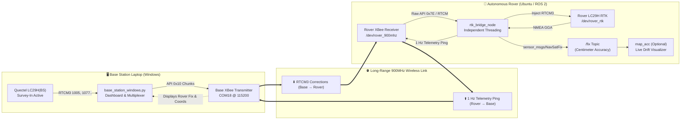

# 🛰️ Rover RTK GPS & Telemetry Module (`gps_data`)

A production-grade **ROS 2** package that interfaces with the **Quectel LC29H Dual-Band RTK GNSS** receiver and **XBee 900MHz** transceivers. Delivers centimeter-level positional accuracy (`RTK FIXED 🔥`), bidirectional RF telemetry, automatic fault recovery, and direct Google Maps-compatible coordinates.

---

## 📑 Table of Contents
- [System Architecture](#-system-architecture)
- [Key Features](#-key-features)
- [Hardware Setup](#-hardware-setup)
- [Static Device Naming (udev)](#-static-device-naming-udev)
- [Installation & Build](#-installation--build)
- [Quick Start Guide](#-quick-start-guide)
  - [1. Running the Rover (ROS 2)](#1-running-the-rover-ros-2)
  - [2. Running the Base Station (Windows)](#2-running-the-base-station-windows)
- [ROS 2 API Reference](#-ros-2-api-reference)
- [RTK Positioning Modes Explained](#-rtk-positioning-modes-explained)
- [Troubleshooting & Diagnostics](#-troubleshooting--diagnostics)
- [Repository Structure](#-repository-structure)

---

## 🏛️ System Architecture



---

## ✨ Key Features

- **Centimeter-Level Positioning**: Achieves true carrier-phase `RTK FIXED 🔥` accuracy (1–2 cm) using multi-constellation RTCM3 corrections (GPS, GLONASS, Galileo, BeiDou).
- **Bidirectional RF Telemetry & Ping**: The rover transmits a 1 Hz heartbeat back to the base station displaying rover fix mode, satellite quality, ingested RTCM packets, and coordinates in real-time.
- **Bulletproof Fault Tolerance**:
  - **No Startup Crashes**: Starts normally even if one or both serial modules are unplugged.
  - **Auto-Reconnection**: Automatically detects unplugged or reset USB cables and reconnects within 1–2 seconds.
  - **Independent Subsystems**: If XBee is lost, GPS continues publishing standalone fixes. If GPS is lost, XBee continues receiving RTCM without crashing.
- **Dual XBee Mode Support**: Transparently decodes **XBee API Mode 1** frames (`0x90`, `0x91`, `0x80`, `0x81`) and raw transparent streams with automatic 90-byte MTU safety chunking.
- **Instant Google Maps Coordinates**: Decimal-degree output formatted with 8 decimal places (millimeter precision) ready to copy-paste directly into mapping services.
- **Live GUI Drift Visualizer**: Includes `map_acc`, a real-time scatter plot rendering positional drift relative to 1, 2, 5, and 10 cm reference rings.

---

## 🔌 Hardware Setup

| Device | Typical Interface | Default Static Port | Baud Rate | Role |
|---|---|---|---|---|
| **Quectel LC29H (Rover)** | CP2102N USB-UART | `/dev/rover_rtk` | 115200 | Rover GNSS receiver |
| **XBee 900MHz (Rover)** | FTDI FT232R USB-UART | `/dev/rover_900mhz` | 115200 | Telemetry & RTCM receiver |
| **Quectel LC29H(BS) (Base)** | USB-UART | `COM17` (configurable) | 115200 | Survey-In stationary base |
| **XBee 900MHz (Base)** | USB-UART | `COM18` (configurable) | 115200 | Telemetry & RTCM transmitter |

---

## 🏷️ Static Device Naming (`udev`)

Linux assigns `/dev/ttyUSB0` and `/dev/ttyUSB1` based on boot order. To ensure ports never swap, static udev symlinks are bound to each module's unique chip serial number:

### Automated Setup (One-Time)
Run the automated configuration script in your workspace:
```bash
cd ~/Desktop/rover_module
sudo ./setup_udev.sh
```

### Manual Configuration
Alternatively, create `/etc/udev/rules.d/99-rover-serial.rules`:
```udev
# XBee 900MHz Module (FTDI FT232R)
SUBSYSTEM=="tty", ATTRS{idVendor}=="0403", ATTRS{idProduct}=="6001", ATTRS{serial}=="B0025NTL", SYMLINK+="rover_900mhz rover_900mh", MODE="0666", GROUP="dialout"

# Quectel LC29H RTK GPS (Silicon Labs CP2102N)
SUBSYSTEM=="tty", ATTRS{idVendor}=="10c4", ATTRS{idProduct}=="ea60", ATTRS{serial}=="ac57edb6726cef119a94a3adc169b110", SYMLINK+="rover_rtk", MODE="0666", GROUP="dialout"
```

Reload udev rules:
```bash
sudo udevadm control --reload-rules && sudo udevadm trigger
```

Verify symlinks:
```bash
ls -l /dev/rover*
# lrwxrwxrwx 1 root root 7 ... /dev/rover_900mhz -> ttyUSB0
# lrwxrwxrwx 1 root root 7 ... /dev/rover_rtk -> ttyUSB1
```

---

## 📦 Installation & Build

### 1. Prerequisites (Ubuntu Linux / ROS 2)
```bash
# ROS 2 dependencies
sudo apt update
sudo apt install ros-$ROS_DISTRO-sensor-msgs ros-$ROS_DISTRO-rtcm-msgs

# Python libraries
pip3 install pyserial pynmeagps matplotlib --break-system-packages
```

### 2. Build the Workspace
```bash
cd ~/Desktop/rover_module
source /opt/ros/jazzy/setup.bash      # Or humble / iron
colcon build --symlink-install
```

### 3. Automatic Environment Sourcing (Recommended)
Add the workspace setup to your `~/.bashrc`:
```bash
echo "source ~/Desktop/rover_module/install/setup.bash" >> ~/.bashrc
source ~/.bashrc
```

---

## 🚀 Quick Start Guide

### 1. Running the Rover (ROS 2)

#### Primary Launch (Full Stack with Auto-Reconnect)
```bash
ros2 launch gps_data gps.launch.py
```

#### Launch with Live RTK Drift Visualizer
```bash
ros2 launch gps_data gps.launch.py enable_plot:=true
```

#### Overriding Ports Manually (Without udev rules)
```bash
ros2 launch gps_data gps.launch.py xbee_port:=/dev/ttyUSB0 gps_port:=/dev/ttyUSB1
```

#### Inspecting Available Arguments
```bash
ros2 launch gps_data gps.launch.py --show-args
```

---

### 2. Running the Base Station (Windows)

On the Windows laptop connected to the Base LC29H and Base XBee:

```powershell
python base_station_windows.py --gps COM17 --xbee COM18 --baud 115200
```

#### Live Base Station Dashboard Preview
```text
==================================================================
   🛰️  WINDOWS RTK BASE STATION -> XBEE TRANSMITTER PIPELINE    
==================================================================
 GPS Port : COM17  |  XBee Port : COM18 @ 115200 baud
------------------------------------------------------------------
 📡 SATELLITES TRACKED  :  24
 📶 GPS FIX STATUS      :  3D FIX (HDOP: 1.10)
 📍 LATITUDE            :  25.8904260°
 📍 LONGITUDE           :  89.4358050°
 🏔️ ALTITUDE            :  52.50 m
------------------------------------------------------------------
 ⏱️ SURVEY-IN PROGRESS:
    Elapsed Duration    :  300s / 300s [████████████████████] 100%
    Current Accuracy    :  0.850 m (Target: < 2.0 m)
    RTCM Packets to XBee:  160 packets

   STATUS: SURVEY COMPLETE! BROADCASTING TO ROVER (ACTIVE)        
------------------------------------------------------------------
 🤖 ROVER RF LINK & TELEMETRY (PING FEEDBACK):
    Rover RF Link       :  CONNECTED & TRANSMITTING (Ping: 1s ago)
    Rover GPS Module    :  CONNECTED
    Rover Fix Mode      :  RTK FIXED 🔥
    Rover RTCM Ingested :  158 pkts received
    Rover Coordinates   :  25.89042614, 89.43580512
==================================================================
 Press Ctrl+C to stop.
```

---

## 📡 ROS 2 API Reference

### Nodes

#### 1. `rtk_bridge_node` (Main Node)
Directly bridges XBee serial receiver and LC29H GPS module. Handles RTCM injection, bidirectional telemetry pings, and coordinate extraction.
- **Published Topics**:
  - `/fix` (`sensor_msgs/msg/NavSatFix`): Standard GPS fix with mapped RTK status (`STATUS_GBAS_FIX` for RTK, `STATUS_FIX` for standard GPS).
- **Parameters**:
  - `xbee_port` (*string*, default: `"/dev/rover_900mhz"`): Serial port for XBee.
  - `gps_port` (*string*, default: `"/dev/rover_rtk"`): Serial port for LC29H.
  - `baud_rate` (*int*, default: `115200`): Serial baud rate.
  - `frame_id` (*string*, default: `"gps_link"`): TF frame ID.

#### 2. `rover_gps_node` (Network / Topic Mode)
Alternative node for setups using network NTRIP casters instead of direct serial XBees.
- **Subscribed Topics**:
  - `/rtcm` (`rtcm_msgs/msg/Message`): Injects incoming RTCM correction packets into GPS.
- **Published Topics**:
  - `/fix` (`sensor_msgs/msg/NavSatFix`): Rover coordinates.

#### 3. `map_acc` (Drift Visualizer GUI)
Live Matplotlib animation node plotting East/North drift in real-time with 1, 2, 5, and 10 cm reference rings.
- **Subscribed Topics**:
  - `/fix` (`sensor_msgs/msg/NavSatFix`)

---

## 🎯 RTK Positioning Modes Explained

As RTCM corrections flow from the Base Station, the system status progresses:

$$\text{NO FIX} \longrightarrow \text{GPS} \longrightarrow \text{DGPS} \longrightarrow \text{RTK FLOAT} \longrightarrow \text{RTK FIXED}$$

| Status in Logs | Quality Code | Accuracy | Description |
|---|:---:|:---:|---|
| `NO FIX` | `0` | None | Module searching for satellites. |
| `GPS` | `1` | 1.5 – 3.0 m | Standalone single-point GPS fix. No RTCM received yet. |
| `DGPS` | `2` | 0.5 – 1.5 m | Differential GPS. First RTCM packets arriving from Base. |
| `RTK FLOAT ⚡` | `5` | 10 – 50 cm | Carrier-phase differential active; integer ambiguities resolving. |
| `RTK FIXED 🔥` | `4` | **1 – 2 cm** | **Full RTK ambiguity resolution locked. Centimeter-grade precision.** |

---

## 🔍 Troubleshooting & Diagnostics

### 1. Rover says `❌ XBee: DISCONNECTED` or `⏳ WAITING for base RF...`
- Verify the USB cable is plugged in and recognized: `ls -l /dev/rover_900mhz` (or `/dev/ttyUSB*`).
- Confirm the Base Station script is running on Windows and showing `RTCM Packets to XBee: > 0`.
- Confirm both XBees share the same **PAN ID**, **Channel**, and baud rate (**115200**).

### 2. Rover stays stuck on `GPS` or `DGPS` and won't reach `RTK FIXED 🔥`
- Ensure the rover antenna has an **unobstructed 360° view of open sky** (keep away from tall concrete walls or indoor roofs).
- Wait for the Base Station's Survey-In duration to finish (target accuracy < 2.0 m).
- Check that the base and rover track common constellations (LC29H supports GPS + GLONASS + Galileo + BeiDou).

### 3. Permission Denied on `/dev/ttyUSB*`
Ensure your user belongs to the `dialout` group:
```bash
sudo usermod -aG dialout $USER
# Log out and log back in for changes to take effect
```

---

## 📁 Repository Structure

```text
rover_module/
├── src/gps_data/
│   ├── gps_data/
│   │   ├── __init__.py
│   │   ├── rtk_bridge_node.py   # Primary node: Bidirectional XBee RTK Bridge & auto-reconnect
│   │   ├── gps_node.py          # Topic-based GPS node (/rtcm -> GPS -> /fix)
│   │   └── map_acc.py           # Real-time Matplotlib RTK drift visualizer GUI
│   ├── launch/
│   │   └── gps.launch.py        # Central launch file supporting all options & arguments
│   ├── package.xml              # Package dependencies (rclpy, sensor_msgs, rtcm_msgs)
│   ├── setup.py                 # Build configuration & console script entry points
│   └── setup.cfg
├── setup_udev.sh                # Helper script to set up static device rules
└── README.md                    # Comprehensive system documentation
```

---

## 📜 License
This project is licensed under the **MIT License**.
