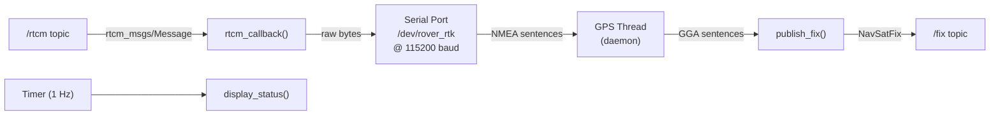

# Codebase Analysis — `rover_module`

## Overview

A **ROS 2 (ament_python)** package named `gps_data` that reads NMEA sentences from a serial GPS/RTK receiver, injects RTCM correction data to achieve RTK-level accuracy, and publishes standard `NavSatFix` messages. It also includes a live drift-visualization tool.

---

## Project Structure

```
rover_module/
├── src/gps_data/                  ← Source package (the only package)
│   ├── gps_data/
│   │   ├── gps_node.py            ← Main ROS 2 node
│   │   ├── map_acc.py             ← Drift visualization node
│   │   └── __init__.py            ← (empty)
│   ├── launch/
│   │   └── gps.launch.py          ← Launch file
│   ├── package.xml
│   ├── setup.py
│   └── setup.cfg
├── build/                         ← colcon build artifacts
├── install/                       ← colcon install artifacts
└── log/                           ← Build logs (Apr–May 2026)
```

---

## Node: `RoverGPSNode` ([gps_node.py](file:///home/rezwan/Desktop/rover_module/src/gps_data/gps_data/gps_node.py))

### Purpose
Reads NMEA data from a serial RTK GPS module, injects incoming RTCM correction packets back into the same serial port, and publishes GPS fixes as `sensor_msgs/NavSatFix`.

### Architecture



### Parameters

| Parameter   | Default          | Description                  |
|-------------|------------------|------------------------------|
| `gps_port`  | `/dev/rover_rtk` | Serial device path           |
| `gps_baud`  | `115200`         | Baud rate                    |
| `frame_id`  | `gps_link`       | TF frame for the NavSatFix   |

### Topics

| Topic  | Type                       | Direction | Description               |
|--------|----------------------------|-----------|---------------------------|
| `/fix` | `sensor_msgs/NavSatFix`    | Publish   | GPS position fix          |
| `/rtcm`| `rtcm_msgs/Message`        | Subscribe | RTCM correction data      |

### Key Details
- Serial reading runs in a **daemon thread**, avoiding blocking the ROS spin loop.
- A `threading.Lock` protects shared state (`lat`, `lon`, `alt`, `quality`, `rtcm_pkt_count`).
- Fix quality codes mapped: `0=NO FIX`, `1=GPS`, `2=DGPS`, `4=RTK FIXED`, `5=RTK FLOAT`.
- `position_covariance_type` is always `COVARIANCE_TYPE_UNKNOWN` — covariance is not computed.
- Status is binary: only `STATUS_NO_FIX` vs `STATUS_FIX`; DGPS/RTK are not distinguished in the status field.

---

## Node: `DriftPlot` ([map_acc.py](file:///home/rezwan/Desktop/rover_module/src/gps_data/gps_data/map_acc.py))

### Purpose
Subscribes to `/fix` and renders a live scatter plot of RTK positional drift relative to the first received fix.

### How it works
1. Records the **first valid fix** as a reference point.
2. Converts subsequent lat/lon deltas to approximate **East/North meters** using a flat-Earth approximation (`× 111000 m/°`).
3. Displays up to **1000 points** in a matplotlib window refreshed every 500 ms.
4. Draws **reference circles** at 1, 2, 5, and 10 cm radii.

> [!NOTE]
> The East conversion uses the same `111000` factor as North, ignoring the `cos(lat)` correction. At most latitudes this introduces a small but non-zero error in the East axis scale.

---

## Launch File ([gps.launch.py](file:///home/rezwan/Desktop/rover_module/src/gps_data/launch/gps.launch.py))

Launches only `gps_node`. 

> [!WARNING]
> **Parameter mismatch**: The launch file passes `port` and `baudrate`, but the node declares `gps_port` and `gps_baud`. These parameters will be silently ignored at runtime, and the node will always fall back to its built-in defaults.

---

## Dependencies

| Dependency        | Where declared       | Notes                                    |
|-------------------|----------------------|------------------------------------------|
| `rclpy`           | `package.xml`        | ROS 2 Python client library              |
| `sensor_msgs`     | `package.xml`        | `NavSatFix`, `NavSatStatus`              |
| `std_msgs`        | `package.xml`        | Declared but **not used** in any source  |
| `rtcm_msgs`       | **Missing** from `package.xml` | Used in `gps_node.py` — should be added |
| `pyserial`        | `setup.py`           | Serial port communication                |
| `pynmeagps`       | **Missing** from both | Used in `gps_node.py` — should be added |
| `matplotlib`      | **Missing** from both | Used in `map_acc.py` — should be added  |

---

## Issues & Recommendations

### 🐛 Bugs

1. **Launch file parameter names wrong** — `port`/`baudrate` don't match node params `gps_port`/`gps_baud`. The node will always use its hardcoded defaults when launched.

2. **East drift calculation ignores `cos(lat)`** ([map_acc.py L69](file:///home/rezwan/Desktop/rover_module/src/gps_data/gps_data/map_acc.py#L69)):
   ```python
   # Current (approximate)
   east = dlon * 111000
   # Correct
   import math
   east = dlon * 111000 * math.cos(math.radians(self.ref_lat))
   ```

3. **`map_acc.py` not registered as an entry point** in `setup.py` — you can't run it with `ros2 run gps_data map_acc`.

### ⚠️ Missing Declarations

4. `rtcm_msgs`, `pynmeagps`, and `matplotlib` are used but not declared in `package.xml` or `setup.py`. This will cause issues during deployment/packaging.

5. `std_msgs` is declared as a dependency in `package.xml` but never imported anywhere.

### 💡 Code Quality

6. **Covariance not populated** — `NavSatFix.position_covariance` is always `[0.0] * 9` with `COVARIANCE_TYPE_UNKNOWN`. Downstream nav/localization nodes that consume covariance (e.g., EKF) will get no useful uncertainty data.

7. **RTK quality not reflected in `NavSatStatus`** — The status only distinguishes `NO_FIX` vs `FIX`. The `NavSatStatus` constants `STATUS_SBAS_FIX` and `STATUS_GBAS_FIX` could be used to signal DGPS/RTK quality.

8. **`display_status` uses `if self.current_lat`** ([gps_node.py L154](file:///home/rezwan/Desktop/rover_module/src/gps_data/gps_data/gps_node.py#L154)) — this will show `"..."` if lat is `0.0` (a valid equatorial coordinate), which is also the same falsy check as `None`.

9. **Bare `except: pass`** in `destroy_node` ([gps_node.py L175-L176](file:///home/rezwan/Desktop/rover_module/src/gps_data/gps_data/gps_node.py#L175-L176)) swallows all exceptions silently during cleanup.
